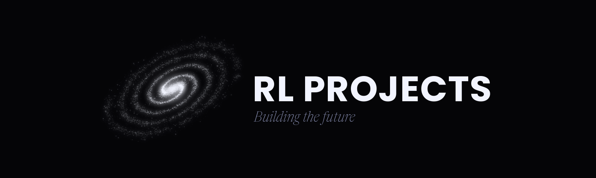

<div align="center">



<h3>People and AI, building software together</h3>

<p>
  <a href="https://renan-lucas-projects.github.io"></a>
  <a href="https://github.com/Renan2010p/openshooter"></a>
  <a href="https://github.com/Renan2010p/neko"></a>
</p>

<p>
  <a href="https://renan-lucas-projects.github.io"><b>Visit the website</b></a> ·
  <a href="#projects"><b>Projects</b></a> ·
  <a href="#roadmap-2027"><b>Roadmap 2027</b></a> ·
  <a href="#run-it-locally"><b>Run it locally</b></a>
</p>

</div>

---

**RL PROJECTS** (Renan Lucas Projects) is an organization built to make
software, experiments and games with people and AI working together. People
decide what is worth making and how it should feel; AI helps get there faster.
Everything we release is open source.

This repository is the source of the website at
**[renan-lucas-projects.github.io](https://renan-lucas-projects.github.io)**.

## Projects

| | Project | What it is | License |
| --- | --- | --- | --- |
| 🎮 | **[OpenShooter](https://github.com/Renan2010p/openshooter)** | A free, open source first-person shooter for local networks, with bots for offline play. Runs on Windows, Linux, macOS, Android and FreeBSD. | GPL-3.0 |
| 🐱 | **[Neko](https://github.com/Renan2010p/neko)** | The Godot engine rewritten in Rust: same menus, shortcuts and file formats, built to be lighter, faster and extremely portable. | MPL-2.0 |

## Roadmap 2027

- **OpenShooter 1.2 — Carnival Edition.** Our LAN shooter dresses up for Carnival.
- **Neko 1.0.** The first stable release of the engine.
- **Five Nights With Friends.** Our next game, in development.

## How we work

| What stays with people | What AI speeds up |
| --- | --- |
| The idea, the game design, the story, the look and every call on what goes in. Nothing ships before it has been played, heard and approved. | Tools, ports between languages, tests, code review and prototypes. Work that would take weeks takes hours. |

We work across seven languages: **Rust**, **Zig**, **C**, **C++**, **Luau**,
**GDScript** and **Python**, each where it fits best.

## Run it locally

The site is plain HTML, CSS and JavaScript, with no build step and no
dependencies.

```sh
git clone https://github.com/Renan-Lucas-PROJECTS/Renan-Lucas-PROJECTS.github.io.git
cd Renan-Lucas-PROJECTS.github.io
python3 -m http.server 8000      # then open http://127.0.0.1:8000
```

Pushing to `main` publishes the site through GitHub Pages.

<details>
<summary><b>Project layout</b></summary>

| Path | Contents |
| --- | --- |
| `index.html` | The page: the *Building the future with* slides, about, projects and the 2027 roadmap |
| `assets/css/style.css` | Styles; palette and type scale at the top of the file |
| `assets/js/main.js` | Slide decks (autoplay, arrows, keyboard, swipe) and the screenshot galleries |
| `assets/img/slides/` | Slide backgrounds, all taken from our own projects or generated by code |
| `assets/img/openshooter/`, `assets/img/neko/` | Screenshots |
| `assets/img/lang/` | Monochrome marks for languages, licenses and platforms |
| `assets/fonts/` | Poppins and Newsreader |

**Previewing a slide:** `?slide=3` opens the vision deck on slide 3 and
`?road=2` opens the roadmap on slide 2, both without transitions.
`?only=roadmap` shows a single section.

</details>

## Credits

- Fonts: [Poppins](https://fonts.google.com/specimen/Poppins) and
  [Newsreader](https://fonts.google.com/specimen/Newsreader), SIL Open Font
  License 1.1.
- Language, license and platform marks: [Simple Icons](https://simpleicons.org)
  (CC0 1.0); the Luau mark is a monochrome version of the
  [Luau](https://luau.org) logo. All trademarks belong to their owners. See
  [`assets/img/lang/CREDITS.md`](assets/img/lang/CREDITS.md).
- The galaxy, the slide art and the logo are generated by code by RL PROJECTS.

<div align="center">
<br>
<sub>Made by <a href="https://github.com/Renan2010p">Renan Lucas</a> · RL PROJECTS</sub>
</div>
